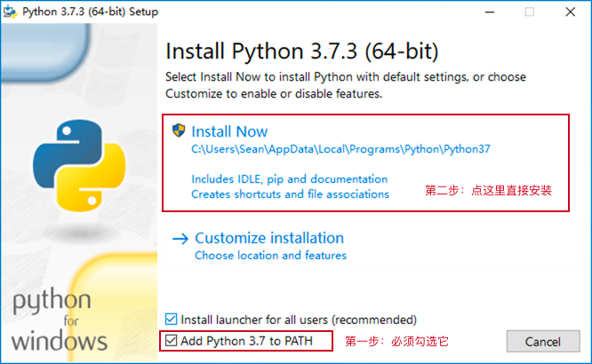
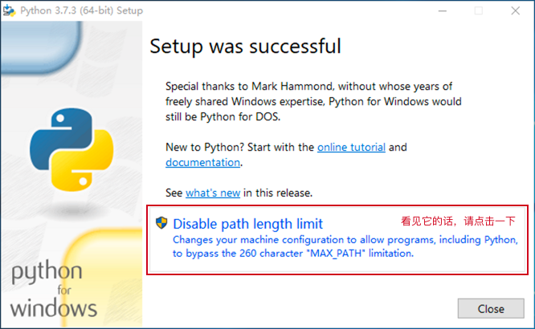
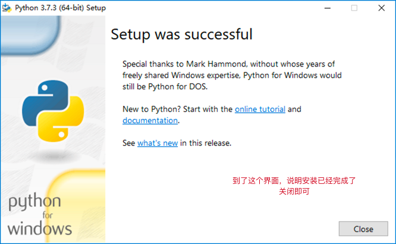
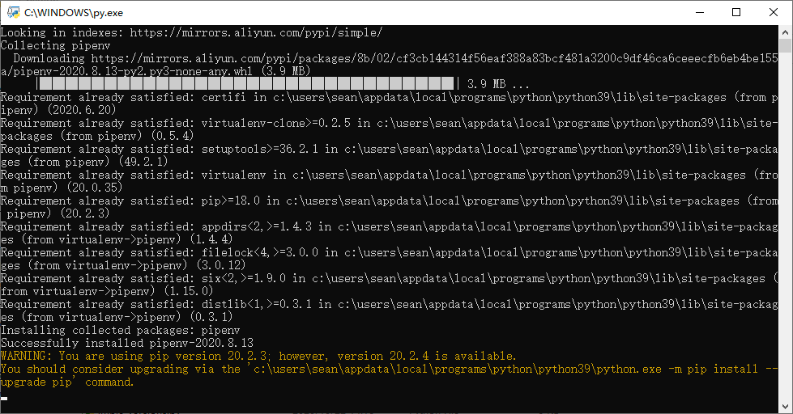
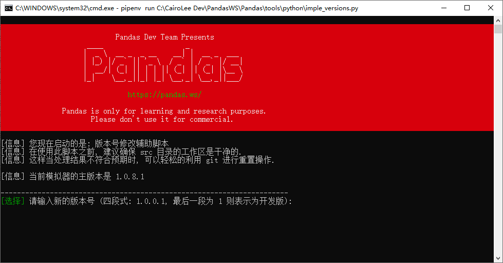

熊猫辅助脚本说明
=============================================

在日常维护 Pandas 的过程中, 有大量重复的工作需要被经常执行, 这些工作通常都有既定的流程或者固定的模式.

为了便于提高工作效率, 我们实现了一些辅助脚本用来进行大量的半自动化工作.

脚本功能简介
--------------------------------------------

- 使用 `create_atcmd.py` 可以轻松的创建一个新的管理员指令
- 使用 `create_scriptcmd.py` 可以轻松的创建一个新的脚本指令
- 使用 `create_battlecfg.py` 可以轻松的创建一个新的战斗配置选项
- 使用 `create_mapflag.py` 可以轻松的创建一个新的地图标记
- 使用 `create_npcevent.py` 可以轻松的创建一个新的 NPC 事件

- 使用 `imple_src2utf8.py` 可以将 src 中的代码全部转换成 UTF8 编码
- 使用 `imple_versions.py` 可以查看、检查和批量调整版本号, 详见[版本号管理](#版本号管理)
- 使用 `imple_translate.py` 可以根据对照表快速翻译部分 DB 信息
- 使用 `imple_extracter.py` 可以提取源码中的字符来构建翻译数据库

- 使用 `dawn_compile.py` 可以执行发布新版本之前的编译工作
- 使用 `dawn_symstore.py` 可以将 `dawn_compile.py` 生成的符号文件归档
- 使用 `dawn_publish.py` 可以构建发布新版本使用的压缩包 (包括自动汉化)


可预见的未来我们还会陆续的添加各种不同的半自动辅助脚本,

这些脚本使用 Python 3.x 版本进行编写, 需要安装 Python 后运行. `imple_versions.py` 仅依赖 Python 3.8+ 标准库; 其他脚本的环境准备见后文.

环境准备
--------------------------------------------

所有辅助脚本都需要先安装 Python. 版本号管理工具要求 Python 3.8+, 使用标准库即可运行; 其他脚本按需安装后文说明的第三方依赖.

### 第一步: 下载 Python 3.x

请直接前往 https://www.python.org/downloads/windows/ 下载安装程序.

通常我们优先选用版本号较高的稳定版本(Stable Releases).

- 若您是 64 位系统, 下载 `Windows x86-64 executable installer` 即可.
- 若您是 32 位系统, 下载 `Windows x86 executable installer` 就可以了.

### 第二步: 安装 Python 3.x

下载完成安装程序后, 直接运行启动它, 在第一个界面中按以下说明进行安装:



若您是第一次安装, 那么安装完成到末尾会有一个选项, 需要您启用它:



最终如果你看到如下图的选项, 那么就说明安装过程已经成功结束了:



### 第三步: 确认 Python 能正常工作

安装完成之后, 打开一个新的 `终端` 或者 `cmd` 窗口, 输入以下指令检查 Python 是否可用:

```
python --version
```

如果 python 指令可用, 那么会显示当前安装的 python 版本号. 例如:

```
python --version
Python 3.13.0
```

确认 Python 版本为 3.8 或更新后, 即可使用下文的[版本号管理工具](#版本号管理).

### 第四步: 准备其他辅助脚本的依赖

使用需要第三方依赖的辅助脚本时, 先检查 pip 是否可用:

```
pip --version
```

如果 pip 指令可用, 那么会显示当前安装的 pip 版本号和安装位置. 例如:

```
pip --version
pip 25.0 from <Python 安装目录>/Lib/site-packages/pip (python 3.13)
```

#### Windows

直接双击依赖环境初始化的辅助脚本 (例如: `create_atcmd.py`), 第一次程序会自动安装必要的依赖, 它会自动检查并安装 `pipenv` 且会自动运行 `pipenv install` 来安装或更新虚拟环境:



若有卡顿请稍作等待, 如果程序执行一切顺利, 你就会看到红色的 Pandas 脚本欢迎界面:



关于依赖更新: 程序已经处理好了一切, 现在你什么都不用管, 该更新的时候程序会自动更新.

#### Linux

如果您使用 Linux 系统, 那么我们相信您应该有非常丰富的计算机知识.

1. 请使用 `pip install pipenv` 安装 `pipenv`
2. 使用 `cd` 指令切换到 `tools\python` 目录
3. 执行 `pipenv install` 完成虚拟环境的初始化工作

以后若需要运行这些辅助脚本, 则在 `tools/python` 目录下使用 `pipenv shell` 进入虚拟环境的 Shell 并使用 `python create_atcmd.py` 这样的方式来运行脚本即可.

如果您喜欢, 也可以直接使用 `pipenv run python create_atcmd.py` 来运行脚本. 更多关于 `pipenv` 的使用方法可以查阅官方文档.

关于依赖更新: 若你发现缺少某些库文件或者看到 `Pipfile.lock` 文件有了更新, 可以在 `tools\python` 目录下使用 `pipenv sync` 或者 `pipenv install` 来更新依赖.

版本号管理
--------------------------------------------

`imple_versions.py` 支持 `show`、`check`、`set` 子命令, 也保留无参数时的交互输入. 在仓库根目录执行以下命令; Windows 可将 `python3` 换成 `python`. 脚本根据自身位置定位仓库, 不要求先切换到 `tools/python`, 不安装依赖、不读取发布凭据、不启动新终端.

```sh
# 查看当前版别、原始版本和对外显示版本
python3 tools/python/imple_versions.py show

# 检查版本字段是否齐全、一致
python3 tools/python/imple_versions.py check

# 预览开发版转正式版, 不写入文件
python3 tools/python/imple_versions.py set 1.2.5.0 --expect-current 1.2.5.1 --dry-run

# 执行同一版本变更, 并核对结果
python3 tools/python/imple_versions.py set 1.2.5.0 --expect-current 1.2.5.1
python3 tools/python/imple_versions.py check

# 开始下一轮开发时, 显式给定下一目标版本
python3 tools/python/imple_versions.py set 1.2.6.1 --expect-current 1.2.5.0

# 查看完整帮助
python3 tools/python/imple_versions.py --help
python3 tools/python/imple_versions.py set --help
```

示例版本按实际情况替换. 四段均须为 ASCII 整数, 每段范围为 `0–65535`, 与 Windows 资源版本字段一致. 社区版沿用第四段 `1` 显示 `-dev` 的规则, 正式版使用 `0`; 专业版沿用 `YYYY.MM.DD.REV`, 非零第四段显示为修订号 `Rev.N`.

| 参数或用法 | 行为 |
| --- | --- |
| 无参数 | 在交互终端提示输入目标版本; Windows 结束时等待 Enter, 便于双击使用 |
| `show` | 显示头文件和资源文件的全部版本字段; 可读取但不一致时仍显示结果并返回 `0` |
| `check` | 检查字段完整性与一致性; 不一致返回 `1` |
| `set <版本>` | 统一活动版别头文件及资源版本; 已一致的文件不重写 |
| `set <版本> --dry-run` | 完成相同的预检, 列出计划修改, 不写文件 |
| `set <版本> --expect-current <旧版本>` | 要求全部活动版本字段都符合旧版本, 不符时终止且不写文件 |
| `--json` | 可放在子命令前或后, 如 `--json show` 或 `show --json`; 输出单个 JSON 对象 |

脚本修改社区版 `src/config/pandas.hpp` 的 `Pandas_Version`, 或专业版 `src/config/professional.hpp` 的 `Pandas_Commercial_Version`, 以及 `src/` 下全部 `.rc` 中的 `FILEVERSION`、`PRODUCTVERSION`、`FileVersion`、`ProductVersion`. 专业版依据 `professional.hpp` 是否存在识别, 并要求其中有有效版本定义; 专业版更新保留社区版头文件的版本.

当前九份资源文件必须齐全, 新增的 `.rc` 也会纳入检查. 写入前读取并校验全部目标字段, 缺失、重复或无效字段会报错. 若现有版本不一致, 可先用 `show` 定位, 再用不带 `--expect-current` 的 `set` 统一到明确的目标版本. 原有编码、BOM、换行和版本字段以外的内容会保留. 写入使用临时文件替换, 失败时尝试恢复已替换的文件; 恢复失败时会报告保留下来的原文件副本路径.

工具只修改程序版本字段. CHANGELOG 日期、SQL 文件核对及 Git 操作按[发布正式版](../../doc/development/how-to/publish-release.md)另行执行.

### 自动化输出与退出码

命令行模式全程不询问、不暂停. 无参数且没有交互终端时返回用法错误. 使用 `--json` 时, 成功与错误都以单个 JSON 对象写入标准输出, 标准错误保持为空; `--help` 仍输出常规帮助文本.

JSON 公共字段包括 `ok`、`command`; 正常读取的结果还包含 `edition`、`version`、`community_version`、`display_version`、`consistent`、`issues` 和 `files`. `files` 列出相对路径、各字段版本及是否属于当前活动版别. 错误结果包含 `error`.

`set` 额外返回 `target_version`、`target_display_version`、`dry_run`、`planned_changes` 和 `changed_files`. 其中 `version`、`consistent`、`files` 是操作前快照, `planned_changes` 给出各文件的 `path`、`from` 版本列表和 `to` 目标版本, `changed_files` 列出实际写入路径; 预览或无需修改时该列表为空. 写入后可用 `check --json` 读取最终状态.

| 退出码 | 含义 |
| --- | --- |
| `0` | 成功, 包括预览和无需修改 |
| `1` | 版本不一致（`check`）、文件/字段异常、旧版本不符或读写失败 |
| `2` | 参数或目标版本格式错误 |
| `130` | 用户中断操作 |

### 验证版本工具

```sh
python3 tools/python/tests/test_versions.py
```

测试在临时仓库副本中执行真实命令, 覆盖预览、写入、一致性检查、版别、编码和异常处理; 不改当前工程的版本号.

YAML 完整性检查
--------------------------------------------

完成前文的第三方依赖准备后, 在 `tools/python` 目录执行:

```sh
pipenv run python tests/test_yaml.py
```

检查 Git 跟踪的全部 `.yml` 和 `.yaml` 文件, 排除 `3rdparty` 目录. 调用发布脚本实际的 YAML 加载入口, 由 `ruamel.yaml` 按 UTF-8/BOM 读取原始字节, 检查语法及重复键; 不再用通用编码探测猜测 YAML 编码.

测试还按发布脚本中的 YAML 转译配置, 对 PRE/RE 的物品、技能、任务和魔物数据库分别执行简体、繁体的读取、替换和保存, 再解析临时输出, 核对译名、未修改字段及 Unicode 原文. 发布转译在保存前严格检查 `Body` 内所有字符串字段值能否转换为目标 GBK / BIG5; 遇到不可表示的字符, 报出文件、条目 ID、字段和码点并停止, 须修正源数据或译名后重试. 外部文件继续保存为 UTF-8, 不丢弃字符或替换成问号来通过检查.

回归用例覆盖无 BOM 的 UTF-8、BOM、非法字节、重复键, 以及合法 UTF-8 但无法转换为目标 ANSI 的名称与脚本字符串. 输出检查进度, 失败返回非零退出码; 不运行发布初始化、读取发布凭据或修改源码数据. 可用 `pipenv run python tests/test_yaml.py YamlEncodingTest` 单独运行编码回归.

更新数据库后及正式打包前运行完整检查. Jenkins 在启用 `publish_package` 时会于编译前自动执行, 失败即停止该次构建. 这一步验证 YAML 转译, 完整发行包的其他文本转换、目录整理及二进制仍由后续打包验收覆盖.
